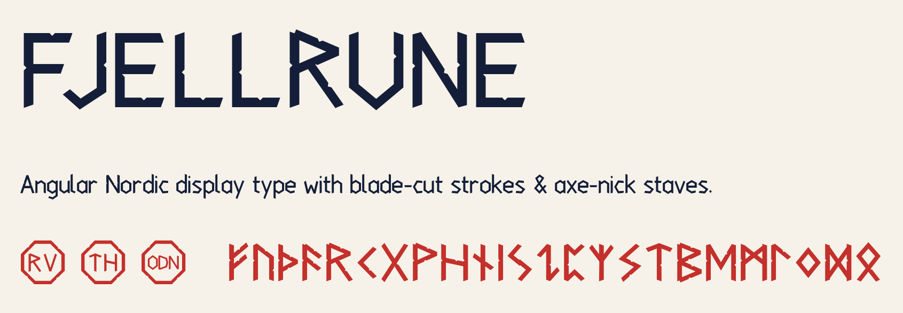
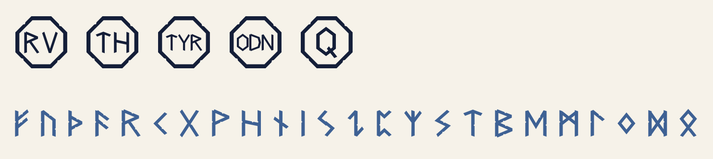
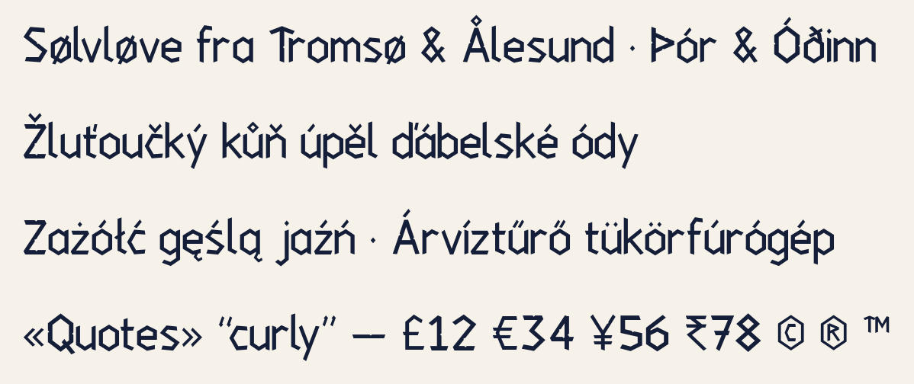
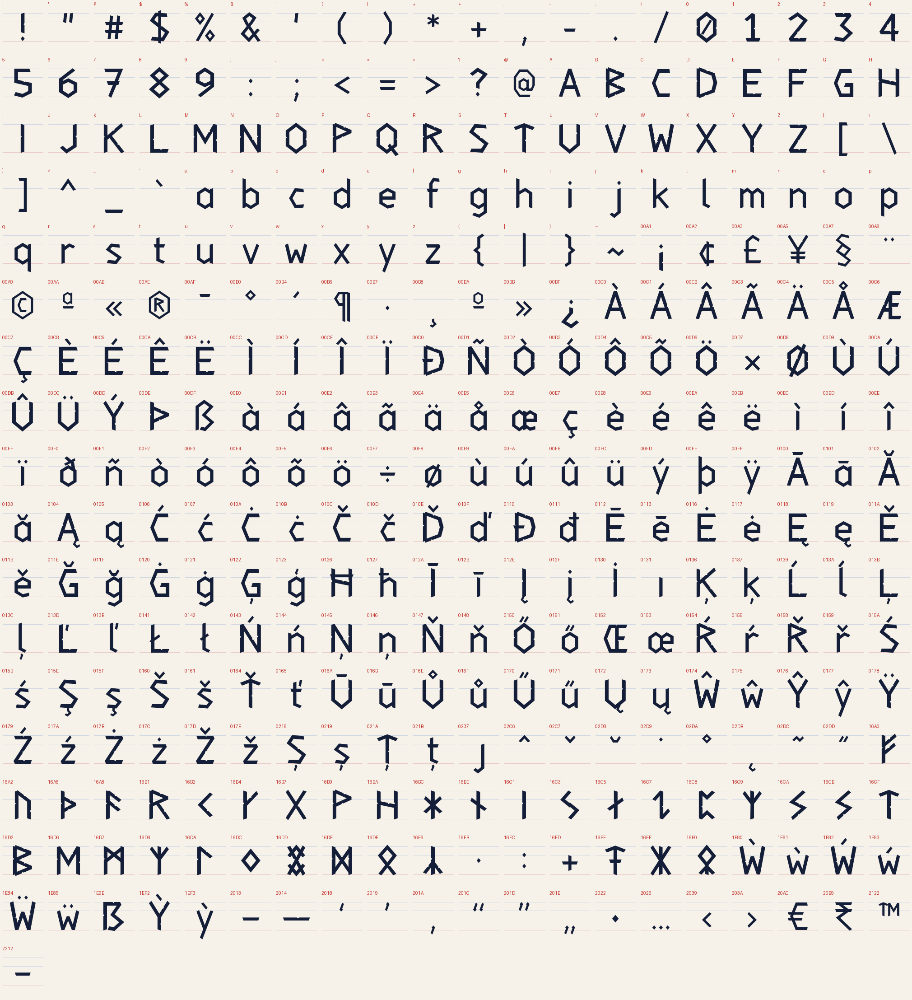

# Fjellrune



Fjellrune is an angular Nordic display typeface inspired by Elder Futhark geometry and carved runestone lettering. Every letter, figure, symbol, and rune is drawn from straight, blade-cut strokes with chamfered terminals and mitred vertices, and every long stave carries Fjellrune's signature **axe nick** — a sharp triangular bite cut into its leading edge.

**[See the specimen](https://q78717.github.io/font-fjellrune/)** · **[Download the fonts](https://github.com/q78717/font-fjellrune/releases/latest)**

## Rune-Shield Medallions & Elder Futhark

Type one to three letters between `<` and `>` and Fjellrune sets them inside an octagonal Nordic rune-shield medallion: `<RV>`, `<TH>`, `<ODN>`, `<Q>`. Lowercase works too.



- Uses the font's contextual alternates (`calt`) and standard ligatures (`liga`), which are on by default in browsers, Figma, and Adobe apps.
- Four or more letters, spaces, or anything other than A–Z are left as plain text, so `a < b` is unaffected.
- Includes native coverage of the Unicode **Elder Futhark & Nordic Runic** block (`U+16A0`–`U+16F0`), drawn with the same blade-cut geometry and axe-nicked staves.

## Character set

Google Fonts' Latin Core set: the Latin languages of Northern, Western, Central, and Eastern Europe (including `Æ`, `Ø`, `Å`, `Þ`, `Ð`, `Œ`, `ß`, `ẞ`), with curly quotes, dashes, currency signs (`$`, `¢`, `£`, `¥`, `€`, `₹`), and combining accents (`mark`/`mkmk`), plus the Runic block.



Fjellrune is a display face: it reads best at 28 px and up, and medallions at 48 px and up.



## Using the fonts

**Desktop:** download the latest release and install `Fjellrune-Regular.ttf`.

**Web:** use `Fjellrune-Regular.woff2`.

```css
@font-face {
  font-family: "Fjellrune";
  src: url("Fjellrune-Regular.woff2") format("woff2");
  font-display: swap;
}
```

## Building from source

Every glyph is a short Python function in `sources/build_fjellrune.py` that constructs blade-cut polygons, merges them with `skia-pathops`, computes class kerning across glyph profiles, and writes the UFO source in `sources/ufo/`; [gftools builder](https://github.com/googlefonts/gftools) then compiles and hints the fonts. The repository follows the [Google Fonts project template](https://github.com/googlefonts/googlefonts-project-template).

```sh
make build    # sets up venv/ from requirements.txt, then runs sources/build.sh
make test     # checks the fonts with fontspector (cargo binstall fontspector)
make proof    # HTML proofs in out/proof (cargo binstall diffenator3)
make images   # redraws the PNG images in documentation/images
```

`sources/build.sh` is the single build command: it writes `sources/ufo/`, compiles `sources/config.yaml` into `fonts/ttf/` and `fonts/webfonts/`, rebuilds `documentation/specimen/index.html`, and smoke-tests the medallion feature.

Dependencies are listed in `requirements.in`; `make update` regenerates the pinned `requirements.txt`. To check with FontBakery instead of fontspector, use a separate environment: `pip install -r requirements-qa.txt`.

## Licence

Copyright 2026 The Fjellrune Project Authors. Fjellrune is licensed under the [SIL Open Font License 1.1](OFL.txt): free to use, modify, and redistribute, including commercially, but the fonts may not be sold on their own.
